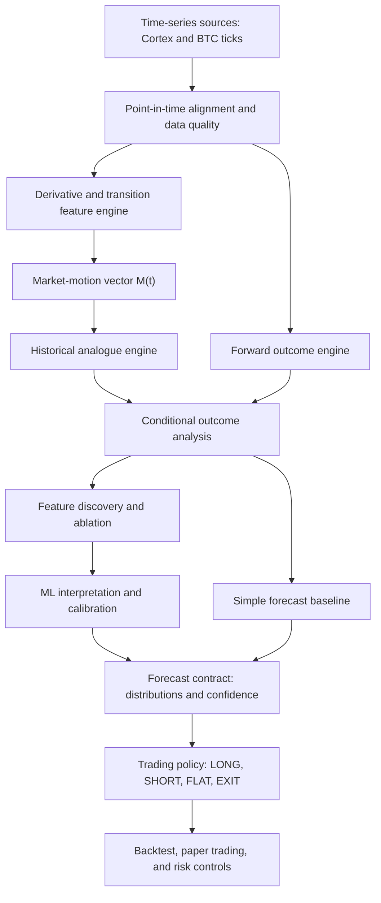

# Crypto Market-Motion Vector Research

## Project Charter and Research Plan

| Field | Value |
|---|---|
| Project | Crypto Market-Motion Vector Research |
| Repository | `malawand/dev-calculin-ml-models` |
| Baseline branch | `features_analysis` |
| Target location in repository | `features_analysis/PROJECT_PLAN.md` or repository-root `PROJECT_PLAN.md` |
| Document version | 0.3 |
| Status | Draft source of truth; research thresholds require approval before the locked test is opened |
| Last updated | 2026-08-24 |
| Initial asset | BTCUSDT |
| Initial sampling frequency | Hourly |

---

## How to read this plan

Sections 1–7 explain the project in plain language: the problem, the proposed solution, and what success would look like. The later sections turn that idea into precise software and research requirements. They are more technical because they must tell us exactly how to build and test the system without accidentally using future information.

When this document uses **causal**, it means “calculated only from information that was available at that time.” It does not mean that a feature has been proven to cause a BTC move.

When this document uses **future-return distribution**, it means the full range of what happened next in similar historical cases—not just whether BTC finished up or down.

---

## 1. Executive summary

We have several curves that describe BTC market movement over different periods, such as 2 hours, 4 hours, 7 hours, 24 hours, and 7 days. These curves do not all turn at the same time. A short-term curve may be recovering while a long-term curve is still weakening. That relationship may tell us more than any single curve on its own.

The project will turn those curves into one structured snapshot of the market at each hour. We call that snapshot the **market-motion vector**:

\[
\mathbf{M}_t = [M_{2h,t}, M_{4h,t}, M_{7h,t}, M_{12h,t}, M_{24h,t}, M_{48h,t}, M_{7d,t}]
\]

In plain language, \(\mathbf{M}_t\) means “what the market's movement looks like at time \(t\), viewed through several time windows.” It is similar to a fingerprint of the market at that moment.

For each time window, the snapshot should answer four basic questions:

1. Has the curve turned upward after a trough, or downward after a peak?
2. Is the curve unusually high, unusually low, or near its normal level?
3. How quickly is it moving?
4. Is that movement becoming stronger or weaker?

An optional fifth feature may describe where the curve appears to be within a broader cycle. In mathematical shorthand:

\[
M_{h,t} = [T_{h,t}, Z_{h,t}, V_{h,t}, A_{h,t}, P_{h,t}]
\]

The project does not begin by asking, “Should the bot buy?” It first asks:

> When the market looked and moved like this in the past, what usually happened to BTC afterward—and how wide was the range of possible outcomes?

For example, the answer might be:

```text
We found 240 similar historical moments.

Over the following 24 hours:
- 64% finished above the starting price.
- The middle result was +0.8%.
- One quarter lost more than 0.3%.
- One quarter gained more than 1.9%.
- The worst cases were large enough that this pattern may still be unsafe to trade.
```

This is more useful than saying “state `101` means BUY,” because it shows the likely reward, the possible loss, the amount of historical evidence, and the uncertainty.

The work is separated into six steps so that each claim can be tested on its own:

1. **Describe the market.** Build the vector using only information available at that moment.
2. **Find similar moments.** Search history for market snapshots that looked similar.
3. **Measure what happened next.** Examine returns, gains, losses, and risk after those moments.
4. **Find the useful parts.** Learn which time windows and measurements add real information.
5. **Use ML only if it helps.** Test whether a model improves on the simpler historical comparison.
6. **Make a trading decision later.** A separate policy decides whether the evidence is strong enough to act on.

The most important design rule is:

> The vector describes what the market is doing. The research engine estimates what may happen next. The trading policy decides whether the opportunity is worth the risk.

The existing `features_analysis` branch is the starting point, not a throwaway prototype. It already:

- retrieves three binary transition metrics;
- aligns those metrics with hourly BTC prices;
- calculates the BTC return after a chosen number of hours;
- counts how often every binary state occurred; and
- reports how often BTC went UP, DOWN, or stayed FLAT after each state.

That code provides an early answer to “what happened after this three-bit state?” It does not yet describe the full strength and shape of the curves, report the full range of later returns, find similar continuous market states, or prove that any apparent pattern works on later unseen data. Those are the next problems this plan addresses.

---

## 2. Project purpose

The purpose of this project is to turn the user's visual understanding of the derivative curves into a repeatable research system.

The user has observed that certain curves often turn before others and that some combinations appear to occur before meaningful BTC moves. Today that idea is difficult to test because the market can look similar in one way but very different in another. A few binary bits also group together many situations that may not truly be alike.

The system therefore needs to do four things well:

1. Save a faithful snapshot of how the curves are moving at each hour.
2. Find genuinely similar snapshots in past data.
3. Measure the complete range of what BTC did afterward.
4. Test whether those results continue to hold in later time periods that were not used to design the system.

This turns a visual idea into a question that data can support or reject:

```text
Notice a pattern in the curves
        -> describe the pattern precisely
        -> find every past occurrence
        -> measure what happened afterward
        -> test it on later unseen data
        -> estimate the likely outcome and risk
        -> only then consider a trade
```

The intended result is a research system that can make statements such as:

> “We found 240 valid historical moments that closely resemble the current market. BTC finished higher 64% of the time over the next 24 hours. The middle result was +0.8%, but the weaker cases lost about 2% or more. After estimated trading costs, the opportunity may be favorable, but it is not certain.”

That conclusion can be inspected and challenged. It is materially different from asserting that a binary state such as `101` automatically means BUY.

---

## 3. The problem we are solving

### 3.1 What the user has noticed

The available data contains BTC prices and derivative-related curves calculated over several time periods. When these curves reach peaks, reach troughs, speed up, or slow down, certain combinations appear to happen before recognizable BTC moves.

For example, the short-term curves may have already reached a trough and started rising while the longer-term curves are still falling. That could describe a short-term bounce inside a larger downward move. The reverse combination could describe short-term weakness inside a larger upward move.

The important information may therefore be the **relationship among the curves**, not just the value of one curve.

### 3.2 What the current binary state gets right

The current binary transition representation is useful because it captures **direction through derivative space**:

- `0` currently means the monitored curve has passed a trough and is moving upward.
- `1` currently means the monitored curve has passed a peak and is moving downward.

This convention does **not** mean negative versus positive.

Imagine a curve has the following values:

```text
-10 -> -7 -> -4 -> -1
```

The curve is still below zero, but it is clearly rising after a trough. The transition bit correctly preserves that fact. Likewise:

```text
+10 -> +7 -> +4 -> +1
```

The curve is still above zero, but it is falling after a peak. The raw sign would miss the difference; the transition bit does not.

The transition state therefore answers:

> Which way is this curve moving after its most recent confirmed turning point?

That is the central insight of the existing system, and this project must preserve it.

### 3.3 What the binary state leaves out

The binary transition alone is incomplete, however. The following observations may share the same transition bit but represent different conditions:

```text
deeply negative and recovering rapidly
slightly negative and approaching zero
slightly positive and continuing upward
strongly positive but losing acceleration
```

For example, both of these could have transition `0`:

```text
Case A: the curve has just started recovering from an unusually deep trough.
Case B: the curve is already above zero and near the end of a strong upward move.
```

Those cases may lead to very different BTC outcomes. A binary bit cannot tell them apart.

The same problem exists across time windows. These two states are not equivalent:

```text
State A
2h, 4h, and 7h curves: rising
24h, 48h, and 7d curves: falling

State B
2h, 4h, and 7h curves: falling
24h, 48h, and 7d curves: rising
```

Both contain three rising and three falling curves, but they tell opposite stories about short-term and long-term movement.

### 3.4 The practical research problem

We need a representation that keeps the useful turning-point direction while adding enough context to tell materially different market situations apart.

At each hour, the system should be able to answer:

```text
What are the short-term curves doing?
What are the long-term curves doing?
Where is each curve relative to its normal range?
How fast is each curve moving?
Is that movement strengthening or weakening?
Which time windows agree, and which disagree?
```

Once that snapshot exists, the research system must answer four further questions:

1. Have we seen genuinely similar market snapshots before?
2. What happened to BTC after those snapshots?
3. Were the results meaningfully different from ordinary BTC behavior?
4. Did the difference remain when tested on later data and after realistic trading costs?

### 3.5 Why this is difficult

This problem is easy to get wrong even when a chart or backtest looks convincing:

- We might accidentally use a peak or trough that became clear only later.
- Many neighboring hourly rows may all represent the same market event and falsely look like independent evidence.
- Trying many combinations can produce an attractive pattern by chance.
- A high win rate can hide rare but very large losses.
- An apparent edge can disappear after fees, spread, slippage, or realistic execution delay.
- Market behavior can change between bull, bear, high-volatility, and quiet periods.

The project must therefore solve two problems at the same time:

1. Build a useful description of market motion.
2. Prove honestly whether that description contains repeatable information about what happens next.

The end product is not certainty. It is a well-tested estimate of possible outcomes, their likelihood, and their risk.

### 3.6 The broader idea: motion-state tracking for time series

BTC is the first application, but the underlying problem is more general.

Many systems produce measurements over time. In those systems, it can be useful to know:

```text
Is the measurement rising, falling, or staying steady?
How quickly is it changing?
Is the change speeding up or slowing down?
Has it recently turned after a peak or trough?
Do the short-, medium-, and long-term views agree?
How long has the current state lasted?
```

This makes the project a form of **multi-timescale momentum and turning-point tracking**. A more complete name is a **multi-timescale motion-state system**, because it describes more than momentum alone. It also records position, acceleration or deceleration, confirmed turns, persistence, and agreement across time windows.

The reusable question is:

> When this system was moving like this in the past, what usually happened next?

For BTC, the first approved outcome is the next-24-hour return distribution. In another domain, the outcome might be an outage, a demand spike, a machine fault, a slowdown in sales, or another measurable future event.

#### Possible future applications

| Domain | Example time-series inputs | Example question or outcome |
|---|---|---|
| Online services and cloud operations | Request volume, latency, error rate, CPU, queue depth | Does this motion state usually precede an overload or outage in the next hour? |
| Industrial equipment | Vibration, temperature, pressure, power draw | Does the combination of rising vibration and accelerating temperature usually precede a fault? |
| Energy and utilities | Electricity demand, renewable output, storage level, grid frequency | Is demand accelerating toward a peak, flattening, or beginning to reverse? |
| Sales and customer demand | Orders, revenue, conversion, new customers, cancellations | Is growth still strengthening, or is it positive but slowing toward a peak? |
| Product and user activity | Active users, sessions, engagement, retention, support volume | Does short-term growth represent a temporary spike or a sustained change? |
| Supply chains and logistics | Orders, backlog, inventory, lead time, shipment volume | Does the current state usually precede a shortage, delay, or demand slowdown? |
| Transportation systems | Traffic speed, vehicle count, travel time, arrivals | Is congestion building, stabilizing, or beginning to clear? |
| Cybersecurity operations | Authentication failures, traffic, alert rates, anomaly scores | Does a coordinated acceleration across signals usually precede an incident? |
| Other financial markets | Prices, yields, spreads, volatility, volume | What outcome distribution followed similar multi-timescale market states? |
| Environmental and physical sensors | Temperature, pressure, flow, air quality, water level | Is a measured condition accelerating toward a threshold or returning toward normal? |

High-stakes uses, such as clinical monitoring or safety-critical control systems, may fit the same mathematical pattern but would require domain experts, stronger validation, and separate regulatory and safety controls. Success in BTC would not validate the method for those domains.

#### When the approach is likely to fit

The approach is most promising when:

- measurements are timestamped consistently;
- enough history exists to find repeated states;
- short- and long-term movement both matter;
- the future outcome can be defined clearly;
- the system's measurements are available before the decision; and
- similar historical conditions have at least some reason to remain comparable.

It is less suitable when data is extremely sparse, measurement definitions change frequently, one-time external shocks dominate the process, or interventions continuously change what would have happened next.

#### Scope boundary

The current project will **not** become a generic time-series platform before the BTC research is validated. BTC remains the first test case. If the representation proves useful—or produces clear lessons—the reusable motion calculations may later be separated from BTC-specific sources, outcomes, and trading rules.

---

## 4. What we believe—and how we will test it

### 4.1 Core hypothesis

Our main belief is:

> The combined shape and movement of short-, medium-, and long-term curves may tell us something useful about the range of BTC outcomes that tends to follow.

More specifically, we believe the complete vector may contain information that is missing from both ordinary BTC behavior and the existing binary transition states.

The mathematical statement below expresses that idea. The left side means “BTC outcomes after market states like this one.” The right side means “BTC outcomes in general.” We are testing whether those two groups are meaningfully different:

Formally:

\[
p(R_{t \rightarrow t+k} \mid \mathbf{M}_t)
\neq
p(R_{t \rightarrow t+k})
\]

The hypothesis is useful only if the difference:

- appears over at least one practical future period, such as the next 12 or 24 hours;
- continues to appear in later time periods;
- is large enough to matter after realistic costs; and
- was not created by accidentally using future information.

### 4.2 Supporting hypotheses

1. Knowing whether a curve is rising after a trough or falling after a peak tells us something different from merely knowing whether it is above or below zero.
2. Knowing whether the curve is unusually high or low adds useful context.
3. Knowing its speed and whether that speed is increasing or decreasing helps distinguish weak moves from strong ones.
4. The relationship among several time windows contains more information than one time window alone.
5. Historical moments with similar vectors should have more similar later outcomes than randomly chosen moments.
6. A smaller group of reliable measurements will probably work better than keeping every possible noisy feature.

### 4.3 What would prove the idea unsupported?

This is a testable idea, not an assumption that must be defended. We should consider it unsupported if, after the agreed data and testing requirements are met:

- similar historical moments do not behave differently from BTC history in general;
- the apparent advantage disappears on later unseen data;
- one unusual market event creates most of the result;
- the result disappears when we remove overlapping examples or enforce realistic timing;
- the expected advantage is smaller than plausible fees, spread, slippage, and execution uncertainty; or
- a much simpler method performs just as well or better.

Finding no reliable signal would not make the project a failure. A trustworthy negative result prevents us from risking money on an idea that only looked convincing in hindsight.

---

## 5. Goals

### 5.1 Primary goals

- Define and generate a multi-timescale market-motion vector \(\mathbf{M}_t\) using only information available at that time.
- Preserve the existing peak/trough transition concept while adding continuous context.
- Build a research dataset that correctly separates what was known then from what happened later.
- Find and inspect historical market snapshots similar to a chosen snapshot.
- Measure the full range of later outcomes, not only UP, DOWN, or FLAT.
- Identify which time windows and measurements provide reliable information.
- Compare historical matching, simple statistical methods, and understandable ML models.
- Produce probability estimates that match reality closely enough for a separate trading policy to use.
- Make every experiment repeatable and protect tests from accidental future information.

### 5.2 Secondary goals

- Give every measurement a clear definition and version.
- Use the same calculation rules in historical research and eventual live operation.
- Show low confidence when too few similar examples exist or when the market is behaving differently from the available history.
- Build a foundation that may later support other crypto assets without assuming BTC results will transfer automatically.
- Keep a clean conceptual boundary between reusable motion-state calculations and BTC-specific data, outcomes, and trading decisions, without expanding the current implementation scope.

---

## 6. Non-goals

The following are explicitly outside the initial research scope:

- Guaranteeing profits or eliminating trading risk.
- Allowing an ML model to invent the entire trading strategy without clear rules.
- Trading real money before honest historical testing and paper trading pass.
- Treating prediction accuracy alone as proof that a strategy is useful.
- Choosing patterns because they happen to look good in the final unseen test period.
- Randomly splitting hourly observations into train and test sets.
- Using peaks, troughs, averages, or revised values that were not actually knowable at the time.
- Starting with deep learning when a simpler method can answer the question.
- Optimizing every derivative horizon, transformation, threshold, and trading rule simultaneously.
- Assuming the same representation, thresholds, or execution policy applies to every asset or market regime.
- Combining the market description and the trading/execution decision into one opaque system.
- Building a general-purpose time-series platform before the BTC representation and research method have been tested.

---

## 7. Guiding principles

1. **Never use the future to describe the past.** Every value in \(\mathbf{M}_t\) must use only information available by time \(t\), including realistic data and processing delays.
2. **Save detail before simplifying it.** Keep the continuous source values and derive binary or category labels from them. Do not throw the original information away.
3. **Keep the actual return.** UP/DOWN/FLAT is a convenient summary, but the continuous return is the main outcome.
4. **Understand the range before making a decision.** Measure likely gain, likely loss, unusual outcomes, and uncertainty before considering a position.
5. **Beat simple comparisons first.** A complex model must do better than BTC history in general, the existing transition bits, and straightforward historical matching.
6. **Test in time order.** Train on earlier data and test on later data. Never shuffle the timeline randomly.
7. **Keep one final test untouched.** Do not examine the final time period until the design and passing rules are frozen.
8. **The result must matter after costs.** A tiny statistical improvement is not useful if fees and execution costs consume it.
9. **Low confidence should lead to no action.** Too few similar examples, distant matches, changing market behavior, or unreliable inputs should reduce confidence or cause the system to abstain.
10. **A forecast is not a trade.** Forecast quality and trading performance are separate claims and must be tested separately.

---

## 8. Conceptual architecture



### 8.1 Component boundaries

| Component | Responsibility | Must not do |
|---|---|---|
| Source ingestion | Retrieve versioned metric and price observations | Calculate future outcomes |
| Alignment/quality | Place inputs on an hourly UTC grid and record missingness/staleness | Backfill with future values |
| Vector engine | Compute \(\mathbf{M}_t\) from information available at \(t\) | Emit trades |
| Outcome engine | Calculate returns and path-dependent outcomes after \(t\) | Feed future information into features |
| Analogue engine | Rank eligible historical vectors and measure neighbor support | Include future or embargoed observations |
| Statistical analysis | Compare conditional and unconditional distributions | Turn exploratory findings directly into live rules |
| ML interpretation | Estimate calibrated probabilities/distributions and feature effects | Own execution or risk limits |
| Trading policy | Convert forecasts into actions under costs and risk constraints | Recompute or alter the market representation |
| Execution/risk | Size, place, monitor, and exit positions | Redefine the research target after seeing results |

---

## 9. Key terms in plain language

| Term | Definition |
|---|---|
| Motion state | A snapshot describing a time series' position, direction, speed, acceleration, recent turns, persistence, and data quality. |
| Momentum | The direction and strength of recent movement. In this project it is one part of the broader motion state. |
| Observation time \(t\) | The hour for which we are creating a market snapshot. |
| Curve horizon \(h\) | The time window used by a curve, such as 2h, 4h, or 7d. |
| Outcome horizon \(k\) | How far forward we look to measure what happened, such as the next 12h or 24h. |
| Derivative value \(D_{h,t}\) | The actual numeric value of a derivative-related curve for time window \(h\) at time \(t\). Its exact source and formula must be recorded. |
| Transition \(T_{h,t}\) | Whether a curve is moving upward after a trough or downward after a peak. |
| Position \(Z_{h,t}\) | Whether the curve is unusually high, unusually low, or near normal compared with its own past. |
| Velocity \(V_{h,t}\) | How quickly the curve is moving. |
| Acceleration/curvature \(A_{h,t}\) | Whether the curve's movement is getting faster, getting slower, or changing shape. |
| Phase \(P_{h,t}\) | An optional description of where the curve is within a broader rise-and-fall cycle. |
| Market-motion vector \(\mathbf{M}_t\) | The complete market snapshot containing the approved measurements from all time windows. |
| Historical analogue | A past market snapshot that resembles the snapshot being examined now. |
| Distance | A numeric score describing how different two market snapshots are. Smaller usually means more similar. |
| Support | How many useful historical examples back an estimate. It should reflect separate market events, not merely many neighboring hours from the same event. |
| Forward return | The BTC gain or loss between the starting price and a later price. |
| Return distribution | The complete range of later returns and how frequently different results occurred. |
| Percentile/quantile | A dividing point in the outcome range. For example, the 5th percentile marks a result that only about 5% of observations fell below. |
| Confidence interval | A range showing uncertainty around an estimate. Wider intervals mean less certainty. |
| MFE | Maximum favorable excursion: the largest helpful move during the future window. For a long position, this is the largest rise from the starting price. |
| MAE | Maximum adverse excursion: the largest harmful move during the future window. For a long position, this is the largest fall from the starting price. |
| Baseline | A simple comparison that the new method must beat, such as ordinary BTC behavior or the existing binary states. |
| Out of sample | Data that was not used to create or tune the feature, method, or rule being tested. |
| Calibration | Whether stated probabilities match reality. For example, events predicted at 60% should occur about 60% of the time. |
| Regime | A broad type of market environment, such as a rising, falling, highly volatile, or quiet market. |
| Leakage | Accidental use of information that would not have been available when the prediction was supposedly made. This is a form of backtest cheating even when unintentional. |
| Walk-forward test | Train on earlier data, test on the next period, then move forward and repeat. |
| Ablation test | Remove one feature or feature group at a time to see whether it was genuinely helping. |
| Purge | Remove training rows whose future-outcome periods overlap the test period. |
| Embargo | Leave an additional time gap between training and testing so neighboring examples do not share too much information. |
| Locked holdout | A final, later period kept completely unseen until all major choices and passing rules are fixed. |
| Abstain | Refuse to issue a forecast or trade when data quality, similarity, or confidence is too low. |

---

## 10. Existing repository baseline

This plan is grounded in the `features_analysis` directory on the `features_analysis` branch of `malawand/dev-calculin-ml-models`, reviewed on 2026-08-22.

### 10.1 What exists now

| Capability | Current implementation | Status |
|---|---|---|
| Cortex feature retrieval | `fetch_cortex_metrics.py` queries three Prometheus/Cortex transition metrics in 180-day chunks. | Implemented |
| Existing binary features | 7d derivative transition, 7d derivative-prime transition, and a weighted 24h/48h/7d polynomial transition. | Implemented |
| Hourly UTC grid | Retrieved features are merged, reindexed hourly, forward-filled, and leading missing rows dropped. | Implemented; staleness controls still needed |
| Truth-table coverage | `truth_table_cortex.py` enumerates all \(2^3=8\) states, including zero-occurrence states, and counts occurrences. | Implemented |
| BTC price alignment | `align_features_with_last_price.py` obtains BTCUSDT hourly close using ClickHouse `argMax(last_price, event_time)` and left-joins on UTC hour. | Implemented |
| Configurable forward return | `count_moves.py` calculates standard or log return over a configurable `--hours` lookahead. | Implemented one horizon per run |
| Hourly semantic shift | Data is reindexed to a complete hourly grid before shifting, so `shift(-N)` represents N hours rather than N observed rows. | Implemented |
| Direction classes | Continuous change is mapped to UP, DOWN, or FLAT using a configurable symmetric threshold. | Implemented |
| Conditional probabilities | Counts and UP/DOWN/FLAT percentages are printed for each binary state and for all observations. | Implemented |

### 10.2 What is not implemented yet

| Capability | Status |
|---|---|
| Continuous derivative magnitudes stored beside transition bits | Not implemented in the current `features_analysis` pipeline |
| Full 2h/4h/7h/12h/24h/48h/7d horizon vector | Not implemented |
| Causal normalized position per horizon | Not implemented |
| Velocity and curvature/acceleration per horizon | Not implemented as the proposed vector schema |
| Phase representation | Concept only; optional pending evidence |
| All forward-return horizons in one canonical dataset | Not implemented |
| Per-state mean, median, standard deviation, quantiles, confidence intervals, or baseline lift | Not implemented |
| MFE/MAE and time-to-MFE/MAE | Not implemented |
| Historical nearest-neighbor/analogue matching | Not implemented |
| Distance-metric learning or empirical feature weights | Not implemented |
| Purged walk-forward evaluation with embargo | Not implemented in this pipeline |
| Feature discovery/ablation for the market-motion vector | Not implemented |
| Calibrated ML forecast for this vector | Not implemented |
| Separate tested trading policy consuming the forecast | Not implemented in this research pipeline |

### 10.3 Baseline constraints that must be addressed

- The current pipeline is configured through constants embedded in scripts; it needs a versioned configuration and command-line or configuration-file interface.
- Feature forward-fill has no explicit maximum staleness. Long source outages could be mistaken for valid persistent states.
- The ClickHouse script contains a hardcoded credential in repository history. The credential must be rotated, removed from current code, loaded from a secret mechanism, and treated as compromised even if a later commit deletes it.
- Source queries and date ranges are hardcoded and not tied to a run manifest.
- The current scripts print analysis results but do not create durable, versioned research tables and metadata.
- Peak/trough transition generation occurs upstream; its causal behavior must be audited. A turning point detected with future samples would create look-ahead leakage even if downstream code is chronological.

---

## 11. Market-motion vector design

The vector is simply a structured set of answers about every time window:

| Symbol | Plain-language question |
|---|---|
| \(T\) | Which way has the curve turned? |
| \(D\) | What is the curve's actual value? |
| \(Z\) | Is that value unusually high or low for this curve? |
| \(V\) | How quickly is the curve moving? |
| \(A\) | Is the movement becoming stronger or weaker? |
| \(P\) | Where might the curve be within a broader cycle? This is optional. |
| \(Q\) | Can we trust this value, or is the source missing, stale, or still warming up? |

The formulas below make those questions precise enough to implement consistently. They are not intended to change the plain-language purpose of the vector.

### 11.1 Canonical vector

Let the initial derivative horizons be:

\[
\mathcal{H} = \{2h,4h,7h,12h,24h,48h,7d\}
\]

For each horizon:

\[
M_{h,t} = [T_{h,t}, Z_{h,t}, V_{h,t}, A_{h,t}, P_{h,t}, Q_{h,t}]
\]

where \(Q_{h,t}\) is a data-quality mask or confidence indicator. The initial production candidate should use \(T,Z,V,A\); phase should remain optional until it demonstrates incremental value.

The complete vector is:

\[
\mathbf{M}_t = [M_{2h,t},M_{4h,t},M_{7h,t},M_{12h,t},M_{24h,t},M_{48h,t},M_{7d,t},C_t]
\]

where \(C_t\) contains a small, predeclared set of cross-horizon relationships if those relationships improve validation results.

### 11.2 Transition \(T\)

The existing raw convention must be preserved for backward compatibility:

```text
transition_raw = 0 -> upward after a trough
transition_raw = 1 -> downward after a peak
```

For mathematical use, create a canonical signed form while retaining the raw field:

```text
transition_direction = +1 -> upward after a trough
transition_direction = -1 -> downward after a peak
```

Required metadata includes:

- transition detection algorithm and version;
- effective timestamp when a turn becomes observable;
- confirmation delay, if any;
- most recent turn type and turn timestamp;
- hours since the most recent confirmed turn; and
- quality flag for missing or stale source data.

The implementation must verify that a trough or peak is not backdated to an earlier timestamp after later data confirms it. If confirmation requires future samples, the feature becomes available only at confirmation time.

### 11.3 Continuous derivative value \(D\)

Store the unnormalized value used by the transition generator:

```text
derivative_raw_{h}
```

Raw values are retained for auditability and possible within-horizon use. They should not be compared directly across horizons without scale normalization.

### 11.4 Normalized position \(Z\)

Position answers: “Where is the current derivative value relative to its own known history?”

Candidate causal normalizations include:

- rolling z-score;
- rolling robust z-score using median and MAD;
- rolling empirical percentile; and
- exponentially weighted mean/scale.

The default candidate should be a clipped robust rolling z-score because derivative distributions may be heavy-tailed:

\[
Z_{h,t} = \frac{D_{h,t}-\operatorname{median}(D_{h,\leq t})}
{1.4826\,\operatorname{MAD}(D_{h,\leq t})+\epsilon}
\]

The actual window length, minimum observations, clipping level, and fallback behavior are configuration values. Statistics at time \(t\) may use data through \(t\) only, or through \(t-1\) if the source timestamp is not guaranteed to be final.

### 11.5 Velocity \(V\)

Velocity answers: “How quickly is the derivative curve moving?”

A basic candidate is:

\[
V_{h,t} = \frac{Z_{h,t}-Z_{h,t-\Delta}}{\Delta}
\]

The implementation should compare one-step differences, short causal regression slopes, and any existing derivative-prime source metrics. Smoothing must be causal. Velocity should be normalized within horizon or derived from normalized position.

### 11.6 Acceleration/curvature \(A\)

Acceleration answers: “Is the curve's motion strengthening or weakening?”

An initial candidate is:

\[
A_{h,t} = \frac{V_{h,t}-V_{h,t-\Delta}}{\Delta}
\]

Existing prime, double-prime, triple-prime, or polynomial metrics may serve as direct inputs or as independent features, but their definitions and causal timing must be documented. Multiple mathematically similar curvature features should not be added without ablation because collinearity can create unstable importance claims.

### 11.7 Phase \(P\)

Phase is a conceptual label for the curve's location within a cycle, for example:

```text
negative expansion
near trough
early recovery
approaching zero upward
positive expansion
near peak
positive contraction
approaching zero downward
```

Phase may be:

- deterministically derived from transition, position, velocity, and curvature;
- represented as a continuous angle or learned embedding; or
- omitted if it duplicates the other components.

Phase is not part of Vector v1's minimum scope. It enters only after a predeclared incremental-value test.

### 11.8 Cross-horizon relationships \(C_t\)

Candidate relationships include:

- number or fraction of horizons moving upward;
- ordered transition pattern from shortest to longest horizon;
- disagreement between short and long horizons;
- dispersion of normalized positions;
- short-minus-long normalized position or velocity;
- time ordering of recent trough/peak transitions; and
- lead/lag relationships between horizon turns.

These features should be explicit and few. The base horizon components remain the source of truth; cross-horizon summaries must be reconstructible from them.

### 11.9 Missingness and quality

Missingness must never be silently converted to a valid market state. Every horizon requires:

```text
source_present_{h}
source_age_minutes_{h}
feature_valid_{h}
normalization_ready_{h}
```

Forward-fill is allowed only up to a configured maximum staleness consistent with how the metric is expected to update. Any longer gap invalidates the affected component and may invalidate the whole vector.

---

## 12. Canonical research data model

In plain language, the research dataset has one row for every valid hour. The first part of the row records what the system knew at that hour. The second part records what BTC did afterward. We join those parts for research, but live inference must be able to access only the first part.

### 12.1 Observation table: one row per UTC hour

Each row represents what was knowable at observation time \(t\).

```text
observation_time_utc
feature_available_time_utc
asset
sampling_frequency
source_run_id
feature_version
vector_version

btc_close_at_t

2h_transition_raw
2h_transition_direction
2h_derivative_raw
2h_position_z
2h_velocity
2h_acceleration
2h_phase_optional
2h_hours_since_turn
2h_feature_valid

... repeated for 4h, 7h, 12h, 24h, 48h, and 7d ...

cross_horizon_features_if_approved

return_1h
return_2h
return_4h
return_8h
return_12h
return_24h
return_48h

mfe_4h
mae_4h
mfe_12h
mae_12h
mfe_24h
mae_24h
mfe_48h
mae_48h
time_to_mfe_*
time_to_mae_*

label_up_down_flat_*_derived
row_quality_flags
```

Feature columns and outcome columns should be kept in logically separate datasets or schema groups even if a convenience view joins them. Live inference code must not load outcome columns.

### 12.2 Outcome definitions

For outcome horizon \(k\):

\[
R_{t,k} = \left(\frac{P_{t+k}}{P_t}-1\right)\times100
\]

Log return may also be stored:

\[
L_{t,k} = \log\left(\frac{P_{t+k}}{P_t}\right)\times100
\]

UP/DOWN/FLAT is a derived analysis label:

```text
UP   if return_k > +threshold_k
DOWN if return_k < -threshold_k
FLAT otherwise
```

The continuous return remains canonical. Thresholds must be versioned and should eventually reflect volatility and expected costs rather than arbitrary fixed percentages.

For a long-oriented path over the next \(k\) hours:

\[
MFE_{t,k}=\max_{0<u\leq k}\left(\frac{P_{t+u}}{P_t}-1\right)
\]

\[
MAE_{t,k}=\min_{0<u\leq k}\left(\frac{P_{t+u}}{P_t}-1\right)
\]

Short-oriented versions can be sign-adjusted or calculated explicitly. Prices used for excursions must match an agreed sampling frequency and executable price convention.

### 12.3 Run manifest

Every generated dataset must have a machine-readable manifest containing at least:

```text
run_id
created_at_utc
git_commit_sha
source_query_hashes
source_start_and_end
row_count
eligible_start_and_end
feature_configuration_hash
outcome_configuration_hash
input_checksums
output_checksums
missingness_summary
timezone
software_environment
```

---

## 13. Historical analogue engine

### 13.1 Purpose

Given a market snapshot \(\mathbf{M}_q\), find valid historical snapshots \(\mathbf{M}_i\) that represent similar market movement, then summarize what BTC did afterward.

The idea is similar to asking:

> Which past hours had short-, medium-, and long-term curves moving most like they are now?

The engine assigns a difference score, called distance, between the current snapshot and each past snapshot. A smaller distance means a closer match. It then looks at the later returns of the closest matches.

### 13.2 Eligibility

An analogue is eligible only if:

- its features were valid and causal at its observation time;
- its full requested outcome window is available;
- it belongs to the allowed training/history period;
- it is outside purge and embargo boundaries;
- it does not violate event-dependence controls; and
- it has the same vector schema and compatible normalization.

### 13.3 Distance

The technical methods below are different ways to calculate “how similar are these two snapshots?” The first version should remain understandable: compare turning direction, position, speed, and acceleration for every time window, then combine those differences into one score.

Initial candidates should include:

1. Gower-style or composite distance for mixed binary and continuous features.
2. Weighted Euclidean distance after causal robust scaling.
3. Manhattan distance as a robustness comparison.
4. Cosine distance only if magnitude information is intentionally de-emphasized.

An interpretable composite starting point is:

\[
d(\mathbf{M}_q,\mathbf{M}_i)
=
\sum_h
\left(
w_T \mathbb{1}[T_{h,q}\neq T_{h,i}]
+w_Z|Z_{h,q}-Z_{h,i}|
+w_V|V_{h,q}-V_{h,i}|
+w_A|A_{h,q}-A_{h,i}|
\right)
\]

Weights begin equal or domain-informed, then may be tuned using training and validation periods only. Learned weights must beat the equal-weight baseline out of sample.

### 13.4 Neighbor selection

Compare both:

- fixed \(k\) nearest neighbors; and
- radius-based neighbors with a minimum and maximum support.

The output must expose:

- neighbor count;
- distance distribution;
- effective independent-event count;
- date/regime concentration;
- conditional return distribution;
- difference from unconditional and matched-regime baselines; and
- an abstention flag when support or proximity is inadequate.

### 13.5 Dependence controls

Hourly vectors from the same multi-day move are not independent evidence. The engine must evaluate at least one of:

- event clustering and one representative per event;
- minimum time separation between selected neighbors;
- block bootstrap confidence intervals; or
- cluster-robust uncertainty estimates.

Raw neighbor count and effective support must both be reported.

---

## 14. Outcome analysis

For every state, group of historical matches, model forecast group, and future period, report more than win rate.

Win rate alone can be misleading:

```text
Pattern A wins 70% of the time but usually gains only 0.2%.
Pattern B wins 60% of the time but usually gains 2.0%.
Pattern C wins 75% of the time but occasionally loses 5.0%.
```

Depending on costs and losses, Pattern A may be worthless and Pattern C may be dangerous. We therefore need the typical result, the full range, the bad cases, the best and worst movement during the window, and the amount of evidence.

### 14.1 Minimum statistics

```text
eligible_observations
effective_independent_observations
mean_return
median_return
standard_deviation
probability_positive
probability_above_cost_threshold
probability_negative
probability_flat_under_defined_band
5th, 25th, 75th, and 95th percentiles
expected_shortfall_or_lower-tail_mean
mean_and_median_MFE
mean_and_median_MAE
MFE_to_MAE_ratio
bootstrap_confidence_intervals
baseline_values
conditional_minus_baseline_lift
```

### 14.2 Baselines

Every analysis must compare against:

- unconditional outcomes for the same calendar/training window;
- a transition-only representation;
- a simple recent-return or momentum baseline;
- a matched broad-regime baseline, if regime definitions are approved; and
- a naive constant probability or mean-return forecast.

### 14.3 Multiple testing

Searching many horizons, transformations, states, and thresholds creates false discoveries. The project must:

- maintain an experiment registry;
- label exploratory versus confirmatory tests;
- predeclare primary metrics before the locked holdout;
- report all tested variants, not only winners;
- use false-discovery-rate control where many parallel hypotheses are evaluated; and
- require replication across multiple chronological folds.

---

## 15. Feature discovery

Feature discovery asks which parts of \(\mathbf{M}_t\) actually help. We test this by adding and removing groups of measurements and checking whether the result changes consistently on later data.

For example:

```text
transition only
transition + position
transition + position + speed
all of the above + acceleration
```

If acceleration adds complexity but does not improve later results, it should not remain merely because it sounds mathematically sophisticated.

### 15.1 Required analyses

- Univariate conditional outcome analysis for each feature.
- Transition-only versus transition-plus-position comparison.
- Incremental addition of velocity, acceleration, and phase.
- Horizon-group ablation: short, medium, and long.
- Leave-one-horizon-out and leave-one-component-out studies.
- Permutation importance computed within time-aware validation.
- Stability of importance rankings across folds and regimes.
- Redundancy and correlation analysis using training data only.
- Sensitivity to normalization window, clipping, and source staleness.
- Comparison of raw derivative inputs with normalized versions.

### 15.2 Retention rule

A feature should remain in the core vector only if it is:

- causally available;
- sufficiently covered;
- numerically stable;
- interpretable or justified by repeatable incremental performance;
- not merely a duplicate of another feature; and
- useful across more than one isolated chronological period.

Feature importance from a single fitted model is not sufficient evidence.

---

## 16. Machine-learning interpretation

ML is optional. It begins only after the dataset, straightforward historical matching, and time-ordered testing are working.

Its job is narrow: combine the vector measurements into a better estimate of what may happen next. Its job is not to invent the feature definitions, hide weak data, or decide how much money to risk. If ML cannot beat the simpler methods reliably, the simpler method wins.

### 16.1 Initial model family

LightGBM is an appropriate first nonlinear model because the data is tabular, interactions may matter, missingness can be handled explicitly, and feature effects can be inspected. It should be compared with:

- constant/unconditional baseline;
- logistic or ordinal regression for direction classes;
- regularized linear or quantile regression for returns;
- nearest-neighbor analogue forecasts; and
- simple tree ensembles.

### 16.2 Forecast targets

Candidate outputs include:

\[
P(R_{t,k}>c \mid \mathbf{M}_t)
\]

\[
E[R_{t,k}\mid \mathbf{M}_t]
\]

and conditional quantiles:

\[
Q_{0.05},Q_{0.25},Q_{0.50},Q_{0.75},Q_{0.95}
\]

The preferred long-term output is a calibrated conditional distribution or set of quantiles, not only a hard class.

### 16.3 Evaluation

The specialist scores below answer a few plain questions:

- Are the probability estimates honest?
- Are the predicted ranges wide enough to include real outcomes at the promised rate?
- Does the method rank stronger and weaker opportunities correctly?
- Does it continue working in later market periods?

Depending on target type, report:

- Brier score and log loss for probabilities;
- calibration curves, expected calibration error, and reliability by fold;
- MAE/RMSE only as secondary regression measures;
- pinball loss and interval coverage for quantiles;
- CRPS if a full distribution is modeled;
- rank correlation and top/bottom forecast-bin separation;
- stability across time and market regimes; and
- economic value after a separately defined policy and costs.

### 16.4 Interpretation

Use time-aware ablation, partial-dependence or accumulated-local-effect analysis, and SHAP only as diagnostic tools. No interpretation method should be treated as causal evidence. Model explanations must be checked for stability across chronological folds.

---

## 17. Trading policy

The forecast describes possible outcomes. The trading policy decides what to do with that information. Keeping them separate lets us distinguish “the forecast was wrong” from “the forecast was reasonable, but the entry, sizing, exit, or cost assumptions were poor.”

The trading policy is downstream of the research forecast and receives a contract such as:

```text
observation_time
forecast_horizon
expected_return
return_quantiles
p_up
p_down
p_above_cost
expected_MFE
expected_MAE
analogue_support
model_uncertainty
out_of_distribution_score
abstain
forecast_version
```

The policy may choose `LONG`, `SHORT`, `FLAT`, `EXIT`, or `NO_ACTION`, but it must be tested separately from representation and forecast quality.

Policy inputs include:

- expected fees, spread, slippage, and funding;
- minimum forecast edge;
- uncertainty and support;
- position and portfolio exposure;
- volatility-based sizing;
- cooldown and minimum holding rules;
- entry/exit timing;
- stop, take-profit, or time exit logic;
- maximum loss and drawdown constraints; and
- exchange and operational risk.

No live order should be authorized merely because an analogue set or model predicts UP.

---

## 18. Research methodology

The order matters. We first prove that the data and timestamps are trustworthy, then build the market snapshot, then measure later outcomes, then try historical matching, and only afterward consider ML or trading rules. Skipping ahead would make it difficult to tell whether a result came from real information or from a flaw in the pipeline.

### 18.1 Research sequence

1. Audit source semantics, transition causality, timestamps, and security.
2. Freeze Vector v1 and Outcome v1 definitions.
3. Build a reproducible point-in-time dataset and data-quality report.
4. Reproduce the current binary truth-table results as a regression baseline.
5. Add continuous derivative value, position, velocity, and curvature.
6. Generate all forward outcomes in one pass.
7. Establish unconditional and transition-only baselines.
8. Implement equal-weight analogue matching.
9. Measure conditional distributions with dependence-aware uncertainty.
10. Perform ablation and stability analysis.
11. Tune limited analogue variants on walk-forward validation only.
12. Train and calibrate simple statistical and ML interpretation models.
13. Freeze all choices and open the locked chronological holdout once.
14. If forecast gates pass, define and test a cost-aware trading policy.
15. Paper trade before considering controlled live deployment.

### 18.2 Experiment record

Every experiment should record:

```text
experiment_id
hypothesis
exploratory_or_confirmatory
dataset_and_manifest
train_validation_test_windows
feature_version
outcome_version
model_or_distance_configuration
primary_metric
secondary_metrics
acceptance_threshold
results_for_every_fold
artifacts
decision
limitations
```

### 18.3 Reproducibility

Given the same source snapshot, configuration, and commit, the pipeline must regenerate identical feature and outcome tables within documented floating-point tolerance. Random processes must use fixed, recorded seeds.

---

## 19. Leakage controls and time-series validation

This section prevents the research from “cheating by accident.” A historical test can look excellent if it uses information that became available only later, treats one long market move as hundreds of separate successes, or lets later market periods influence earlier calculations.

The basic rule is simple:

> At every historical hour, recreate only what the system could truly have known and done at that hour.

The controls below are mandatory. A result that breaks them is invalid regardless of how profitable or accurate it appears.

### 19.1 Point-in-time feature availability

Every value needs two timestamps: the time it describes and the time it actually became available. These are not always the same.

- Record both observation time and feature-available time.
- Use the value that was actually available then, not a later revision.
- Audit upstream derivative and turning-point calculations.
- If a peak/trough needs future samples for confirmation, timestamp the transition at confirmation, not at the apparent extremum.
- Apply realistic query, calculation, and execution latency before assigning a vector to a tradeable timestamp.

### 19.2 Missing data

Missing data must remain visible. We may carry a recently observed value forward for a short, approved period, but we must not pretend an old value is current during a long outage.

- Never backward-fill features.
- Forward-fill only under a declared maximum staleness.
- Preserve missingness and source-age fields.
- Do not calculate a vector when required components are invalid unless the approved model explicitly supports masked inputs.

### 19.3 Calculations that use past information only

Normalizing a value usually requires an average, median, range, or other summary of its history. At each hour, that summary must be calculated from information available by that hour—not from the complete dataset.

- Rolling normalization uses current and past training/history data only.
- Fold-specific scalers, imputers, feature selectors, distance weights, and calibration models are fit only within each training fold.
- No full-dataset mean, standard deviation, percentile, clipping threshold, or PCA transform may be used before splitting.

### 19.4 Label construction

A feature describes what was known at the starting time. A label records what happened later. Keeping those two sides separate is essential.

- Features at \(t\) use no data after \(t\).
- Outcomes use prices strictly after \(t\) according to the declared execution convention.
- The last \(k\) rows without a complete outcome window remain unlabeled, not zero.
- Overlapping outcome windows are treated as dependent observations.

### 19.5 Chronological splits

Random train/test splits are prohibited because they mix future market environments into the past. Use walk-forward evaluation: learn from an earlier period and test on the next period, then move forward and repeat.

```text
Fold 1: train [A........B] validate [C..D]
Fold 2: train [A............D] validate [E..F]
Fold 3: train [A................F] validate [G..H]
Final:  all approved development history -> locked test [I..J]
```

Window dates and the choice of expanding versus rolling training must be specified before final evaluation.

### 19.6 Purging and embargo

Suppose we are measuring the next 24-hour return. A training row from 11:00 on Monday may use prices through 11:00 on Tuesday. If testing begins Tuesday morning, that training row already contains part of the test period. **Purging** removes such overlapping rows. An **embargo** leaves an extra safety gap so nearby observations do not share almost the same price path.

For a maximum label horizon \(k_{max}\):

- remove training observations whose outcome windows overlap validation or test windows;
- apply an embargo of at least the maximum outcome horizon unless a documented dependency analysis justifies a different gap; and
- ensure nearest-neighbor queries cannot select embargoed or future observations.

### 19.7 Tuning and final holdout

We may make choices while looking at development periods. We may not keep changing the system after seeing the final test. Otherwise the “unseen” test quietly becomes another training period.

- Hyperparameters and distance weights are chosen using training/validation folds only.
- If nested time-series validation is not practical, keep the search space small and predeclared.
- The locked holdout is opened once.
- A failed locked test triggers a new research version and a new future holdout, not repeated tuning on the failed holdout.

### 19.8 Regime and event dependence

Ten neighboring hours during one large move are not ten fully separate discoveries. The analysis must account for the fact that nearby observations can belong to the same underlying market event.

- Report results by broad chronological regime without choosing regimes using future outcomes.
- Use block bootstrap or event clusters for uncertainty.
- Ensure a dense cluster of hourly observations from one move does not masquerade as hundreds of independent confirmations.

---

## 20. Success criteria and measurable gates

The gates are stop signs between project phases. Writing the code is not enough: the output, timing, data quality, and tests must also meet the stated requirements before the next phase begins.

These are initial proposed gates. Exact prediction and trading thresholds must be approved and frozen before the final unseen period is examined.

### Gate 0 — Security and source audit

Pass when:

- the exposed ClickHouse credential has been rotated and removed from active code;
- secrets are loaded through an approved secret or environment mechanism;
- every source metric has an owner, definition, unit, update cadence, and timestamp semantics;
- peak/trough transitions have a documented causal availability rule; and
- a source-to-feature timing test demonstrates no use of future observations.

### Gate 1 — Reproducible data foundation

Pass when:

- UTC hourly timestamps are unique and monotonic;
- every missing or stale value is visible in quality fields;
- eligible-period hourly coverage is at least 99%, or every lower-coverage interval is explained and excluded by a fixed rule;
- price/feature alignment passes hand-checked examples around day boundaries and gaps;
- two identical runs produce matching row counts, schema, and checksums; and
- a run manifest is generated automatically.

### Gate 2 — Vector v1

Pass when:

- the seven proposed horizons are available or unavailable horizons are explicitly deferred with evidence;
- transition, raw derivative, normalized position, velocity, acceleration, and quality fields are produced for every included horizon;
- Vector v1 is computable causally in both batch replay and a live-like incremental replay;
- batch and incremental vectors match within tolerance for at least 99.9% of valid observations;
- unit tests cover transition convention, turning-point availability, normalization warm-up, staleness, and missingness; and
- visual spot checks confirm the vector tells the intended market-motion story without using future data.

### Gate 3 — Outcome v1 and baseline report

Pass when:

- returns for 1h, 2h, 4h, 8h, 12h, 24h, and 48h are generated in one dataset;
- MFE, MAE, and time-to-excursion are available for approved horizons;
- ten or more hand-calculated rows match the engine within tolerance;
- transition-only truth-table results from the current pipeline are reproducible;
- conditional mean, median, quantiles, probabilities, uncertainty, and baseline lift are reported; and
- dependent-observation and missing-label behavior is tested.

### Gate 4 — Analogue engine v1

Pass when:

- analogue queries are restricted to eligible historical data;
- equal-weight mixed-feature distance is implemented and inspectable;
- fixed-\(k\) and radius support are evaluated;
- output includes distance, support, effective support, concentration, conditional distributions, and abstention;
- synthetic tests return expected nearest states; and
- no query can select future, purged, or embargoed observations.

### Gate 5 — Evidence of signal

Before the final unseen test, select one main future period and one main scoring method. Proposed minimum evidence during development is:

- the forecast improves the approved probability/distribution score by at least 5% compared with ordinary BTC behavior;
- in the highest-confidence valid cases, the probability of the predicted direction improves by at least 3 percentage points;
- the estimated advantage points in the same direction in at least 70% of the walk-forward test periods;
- uncertainty estimates still support a real difference after accounting for repeated tests and groups of related hourly observations;
- results are not dominated by one event or one regime; and
- the system declines to forecast when it cannot find enough close historical matches or other reliable evidence.

These numerical values are project defaults, not facts about the data. They may be revised once, before final evaluation, with the reason recorded.

### Gate 6 — Feature stability

Pass when:

- the retained vector beats transition-only and simpler baselines;
- each retained feature group has repeatable incremental value or a documented representational reason;
- removing one feature group at a time produces reasonably consistent results across test periods;
- no single feature or narrow time period accounts for most performance; and
- phase, learned weights, and other optional complexity enter only if they improve out-of-sample results.

### Gate 7 — ML interpretation

Pass when:

- the model beats the best simple baseline on the frozen primary metric by the approved margin;
- probability or quantile outputs are acceptably calibrated on every major validation period;
- forecast quality remains positive after latency and source-quality filters;
- model behavior is documented under missing, stale, and out-of-distribution inputs; and
- a simpler model is preferred when performance is statistically and economically indistinguishable.

### Gate 8 — Trading policy and paper trading

Pass when:

- the policy was specified without using the locked test to tune rules;
- backtests include fees, spread, slippage, funding, latency, and rejected/missed fills;
- net expectancy is positive and exceeds estimated round-trip costs by an approved safety multiple, initially proposed as 1.5x;
- performance is not dependent on unrealistic turnover or perfect execution;
- risk limits and maximum acceptable drawdown are approved in advance;
- paper trading matches replay behavior within tolerance over an agreed period; and
- kill switches, abstention, monitoring, and rollback are tested.

### Research success versus trading success

The research project can succeed by producing a valid negative result. Live-trading success is a later and stricter gate requiring both predictive evidence and an executable, risk-controlled policy.

---

## 21. Phased roadmap

### Phase 0 — Charter, audit, and security

**Objective:** Establish shared definitions and remove known validity/security blockers.

**Work:**

- Approve this charter and record unresolved decisions.
- Inventory Cortex metrics and derivative-generation code.
- Audit transition timing for future confirmation/backdating.
- Rotate and remove the committed database credential.
- Define configuration and run-manifest formats.
- Freeze the initial asset, sampling frequency, horizons, and data period.

**Deliverables:** approved charter, source dictionary, timing/leakage audit, secret-management change, experiment template.

**Exit:** Gate 0 passes.

### Phase 1 — Baseline hardening

**Objective:** Turn the existing four scripts into a reproducible baseline.

**Work:**

- Parameterize sources, dates, metrics, files, and horizons.
- Add bounded forward-fill and quality flags.
- Save truth-table and conditional-frequency outputs as durable artifacts.
- Add tests for hourly alignment and forward-return semantics.
- Reproduce existing results from a manifest-defined run.

**Deliverables:** baseline pipeline, tests, run manifest, data-quality report, binary-state baseline report.

**Exit:** Gate 1 passes and current results are reproducible.

### Phase 2 — Market representation: Vector v1

**Objective:** Build \(\mathbf{M}_t\) before adding advanced prediction.

**Work:**

- Retrieve or calculate continuous derivative values for the approved horizons.
- Generate transition raw/signed values, causal normalized position, velocity, acceleration, and quality fields.
- Implement batch and incremental feature calculation.
- Inspect sample periods around known peaks, troughs, recoveries, and horizon disagreements.
- Version the vector schema.

**Deliverables:** vector builder, schema/data dictionary, Vector v1 dataset, unit tests, batch-versus-incremental parity report, visual sanity-check notebook/report.

**Exit:** Gate 2 passes.

### Phase 3 — Outcome engine and distribution analysis

**Objective:** Build the “what happened next?” dataset.

**Work:**

- Calculate all approved returns in one pass.
- Add MFE, MAE, and timing-to-excursion.
- Preserve continuous outcomes and derive labels separately.
- Generate unconditional and transition-only distribution baselines.
- Add block-bootstrap confidence intervals and effective-sample estimates.

**Deliverables:** Outcome v1 table, state-distribution report, baseline comparison, validation tests.

**Exit:** Gate 3 passes.

### Phase 4 — Historical analogue matching

**Objective:** Make the vector directly useful without requiring ML.

**Work:**

- Implement causal fold-specific scaling.
- Build equal-weight mixed-feature nearest-neighbor search.
- Add fixed-\(k\), radius, support, concentration, and abstention behavior.
- Compare distances and limited weight variants under walk-forward validation.
- Produce human-readable analogue cards and outcome summaries.

**Deliverables:** analogue index/query API, evaluation report, analogue summary artifact, tests for chronology and eligibility.

**Exit:** Gate 4 passes; Gate 5 is evaluated.

### Phase 5 — Feature discovery

**Objective:** Identify the smallest stable useful representation.

**Work:**

- Perform component and horizon ablations.
- Evaluate cross-horizon relationships.
- Test optional phase representation.
- Measure stability across folds and regimes.
- Freeze the retained Vector v2 feature set.

**Deliverables:** feature inventory, ablation matrix, stability report, Vector v2 decision record.

**Exit:** Gate 6 passes or the project records a supported negative result.

### Phase 6 — ML interpretation

**Objective:** Determine whether ML adds calibrated value beyond analogue and linear baselines.

**Work:**

- Train simple probability, return, or quantile baselines.
- Train limited LightGBM candidates.
- Calibrate outputs within time-aware folds.
- Compare forecast scores, stability, and interpretability.
- Freeze model and open the locked holdout once.

**Deliverables:** trained model package, feature contract, evaluation and calibration report, model card, locked-test decision.

**Exit:** Gate 7 passes or the simpler analogue/statistical baseline remains the selected forecast engine.

### Phase 7 — Trading policy and backtest

**Objective:** Convert forecast distributions into explicit, cost-aware decisions.

**Work:**

- Define action thresholds, abstention, holding period, sizing, exits, and exposure limits.
- Model execution costs and latency.
- Run event-driven chronological backtests.
- Perform stress, sensitivity, and capacity tests.
- Freeze a paper-trading policy.

**Deliverables:** policy specification, backtest engine/report, cost model, risk controls, deployment checklist.

**Exit:** Backtest portion of Gate 8 passes.

### Phase 8 — Paper trading and controlled deployment

**Objective:** Validate live data parity and operations before capital is at risk.

**Work:**

- Run live vector and forecast calculation without orders.
- Compare live values to batch replay.
- Paper trade with production latency and exchange constraints.
- Monitor drift, quality, calibration, and policy behavior.
- Conduct a formal go/no-go review for any controlled live pilot.

**Deliverables:** live parity report, paper-trading report, monitoring dashboard/spec, operational runbook, go/no-go record.

**Exit:** Gate 8 passes and explicit human approval is given for any live-capital use.

---

## 22. Deliverables

### Documentation

- Approved `PROJECT_PLAN.md`.
- Metric/source data dictionary.
- Vector schema and feature definitions.
- Outcome schema and label definitions.
- Leakage and timestamp audit.
- Experiment protocol and decision log.
- Model card and forecast contract.
- Trading-policy specification and operational runbook.

### Data artifacts

- Versioned aligned source table.
- Vector v1 and selected Vector v2 tables.
- Outcome v1 table.
- Joined research view with a safe feature/outcome boundary.
- Run manifests and data-quality reports.

### Software

- Parameterized ingestion and alignment pipeline.
- Causal batch and incremental vector engine.
- Multi-horizon outcome engine.
- Historical analogue index and query interface.
- Statistical distribution analysis.
- Time-series validation and experiment runner.
- Optional calibrated ML forecast package.
- Separate backtest and policy layer.

### Research reports

- Binary baseline reproduction.
- Outcome-distribution report.
- Analogue-method comparison.
- Feature ablation and stability report.
- Walk-forward and locked-holdout evaluation.
- Cost-aware policy backtest.
- Paper-trading parity and performance report.

---

## 23. Risks and mitigations

| Risk | Why it matters | Mitigation |
|---|---|---|
| Peak/trough look-ahead | A turn identified using later samples makes the feature unrealistically early. | Audit upstream algorithm; timestamp at confirmation; incremental replay test. |
| Hardcoded credential | Exposes infrastructure and remains recoverable from git history. | Rotate immediately; remove from active code; use secrets; consider history cleanup under a separate security procedure. |
| Unbounded forward-fill | Stale metrics appear valid during outages. | Maximum staleness, age fields, invalidation, outage tests. |
| Misaligned timestamps | Hourly feature and price rows may describe different availability windows. | Define bar-close and availability semantics; hand-check boundaries; latency shift. |
| Overlapping labels | Adjacent hourly examples share most of the same future path. | Purging, embargo, event clustering, block bootstrap. |
| Data snooping | Many horizons and thresholds yield accidental winners. | Experiment registry, predeclared primary target, FDR control, locked holdout. |
| Regime dependence | A pattern may work only in one bull/bear or volatility episode. | Walk-forward reporting, regime breakdown, recency tests, abstention/drift controls. |
| High dimensionality | Seven horizons times many features can make analogues sparse. | Start with T/Z/V/A, ablate, shrink/weight, require support, avoid unnecessary phase. |
| Distance concentration | Nearest neighbors may still be far away in high dimensions. | Report absolute distance and neighbor concentration; radius thresholds; OOD abstention. |
| Scale mismatch | Raw values across horizons are incomparable. | Causal within-horizon robust scaling fit per fold. |
| Non-independent analogues | Hundreds of hourly rows can represent one event. | Effective support, minimum separation, event clusters. |
| Classification hides magnitude | UP rate can favor tiny gains and rare large losses. | Keep continuous outcomes; report quantiles, tails, MFE/MAE, expected value. |
| Unrealistic execution | Close-to-close returns may not be captureable. | Lag signals, use executable prices, model spread/slippage/funding, event-driven replay. |
| Source revisions/drift | Metric definitions or distributions may change. | Version sources and queries; monitor distribution and schema drift; immutable snapshots. |
| ML overfitting | Complex interactions can fit noise. | Simple baselines, limited search, nested/strict walk-forward, locked test. |
| Feature importance instability | Model explanations may change across folds. | Ablation and stability analysis; do not infer causality from SHAP alone. |
| Policy/model coupling | Tuning actions and forecasts together hides where value comes from. | Separate forecast contract, model evaluation, and policy evaluation. |
| Operational failure | Missing data or service errors can produce unsafe orders. | Default to no action, quality gates, kill switch, monitoring, rollback. |
| Premature generalization | Building a generic framework too early can distract from testing whether the BTC idea works. | Validate BTC first; extract reusable components only after evidence and lessons exist. |
| Domain transfer | A representation that works for BTC may fail in another system with different noise, timing, or causes. | Treat each new domain as a separate research project with its own baselines, outcomes, validation, and safety rules. |

---

## 24. Open questions and required decisions

Decisions marked “before Vector v1” or “before locked test” must be resolved by that milestone.

| Question | Decision deadline | Current default |
|---|---|---|
| What exact upstream formula defines each derivative and prime metric? | Phase 0 | Undecided; document existing sources |
| Does transition detection require confirmation samples, and when is a turn knowable? | Phase 0 | Assume confirmation time, never backdate |
| Should the raw `0/1` convention remain externally visible? | Vector v1 | Yes, retain raw and add signed canonical value |
| Are all 2h/4h/7h/12h/24h/48h/7d sources available and historically complete? | Vector v1 | Target all seven; explicitly defer unavailable horizons |
| Which normalization method and lookback should be primary? | Vector v1 | Robust rolling z-score; tune on development only |
| What maximum source staleness is acceptable? | Phase 1 | Source-specific; no unlimited forward-fill |
| What is the forecast decision timestamp relative to hourly close? | Phase 1 | After feature and price availability plus measured latency |
| Which future price is executable for outcomes? | Outcome v1 | Next executable bar/tick after signal; compare close convention |
| Which outcome horizon is primary? | Before locked test | Undecided; 24h is a candidate, not yet approved |
| Which return/probability scoring rule is primary? | Before locked test | Proper scoring rule such as CRPS/Brier, target-dependent |
| Which horizons require MFE/MAE? | Outcome v1 | 4h, 12h, 24h, 48h candidates |
| How are FLAT thresholds set? | Outcome v1 | Derived from volatility and cost; continuous return remains canonical |
| What is the minimum analogue support and maximum distance? | Analogue v1 | Determined from training/validation only |
| Should neighbors require minimum time separation? | Analogue v1 | Yes, compare separation/event clustering |
| Is phase explicit or redundant? | Feature discovery | Exclude from minimum Vector v1 |
| Are cross-horizon lead/lag features included? | Feature discovery | Only a small predeclared set |
| Expanding or rolling training window? | Before validation freeze | Compare on development; freeze before holdout |
| How long is the locked holdout? | Before locked test | Must cover multiple regimes if data permits |
| What cost, latency, funding, and slippage assumptions apply? | Before policy test | Conservative scenario set required |
| Is the initial policy long-only or long/short? | Before policy test | Undecided; forecast engine remains symmetric where possible |
| What maximum drawdown and exposure are acceptable? | Before policy test | Human decision required |
| When may the project expand beyond BTCUSDT? | After BTC research gates | Only after BTC pipeline is stable |
| When may reusable motion-state components be extracted into a general engine? | After BTC representation and analogue evaluation | Only after we know which components are genuinely reusable and useful |

---

## 25. Decision log

Use this table to keep the charter current.

| Date | Decision | Rationale | Impact | Owner |
|---|---|---|---|---|
| 2026-08-22 | Represent market motion as a multi-timescale vector rather than only a binary truth table. | Preserve trajectory, position, and intensity across horizons. | Reorients roadmap around representation and conditional distributions. | Project owner |
| 2026-08-22 | Preserve transition direction around peaks/troughs. | Derivative sign alone does not show whether a negative curve is recovering or a positive curve is rolling over. | Raw transition remains a core feature. | Project owner |
| 2026-08-22 | Keep market representation, interpretation, and trading policy separate. | Improves testability, auditability, and risk control. | Defines system architecture and phase gates. | Project owner |
| 2026-08-22 | Build full outcome distributions and analogue matching before relying on LightGBM. | Establishes interpretable evidence and a strong baseline. | ML moves after dataset, outcomes, and analogue engine. | Project owner |
| 2026-08-24 | Recognize BTC as the first application of a broader multi-timescale motion-state concept. | Direction, speed, acceleration, turning points, and cross-timescale agreement can describe many time-series systems. | Documents future use cases while explicitly keeping general-platform work outside the current BTC scope. | Project owner |

---

## 26. Working agreements

- This file is the project source of truth for scope, terminology, gates, and roadmap.
- Material changes require a dated decision-log entry.
- Feature, outcome, distance, and model definitions are versioned independently.
- Every chart and statistic must identify its dataset manifest and experiment ID.
- Exploratory findings are clearly labeled and cannot be promoted to a policy without confirmatory evaluation.
- Failed or neutral experiments are retained.
- The locked test is not used for iteration.
- Research code defaults to no prediction or no action when inputs are invalid.
- Live-capital deployment always requires explicit human approval outside this document.

---

## 27. Definition of done

### 27.1 Research foundation is done when

- the source and timing audit is complete;
- secrets are handled safely;
- the baseline is reproducible;
- Vector v1 and Outcome v1 are documented, versioned, and tested;
- batch and incremental feature calculations agree;
- the analogue engine produces point-in-time-correct conditional distributions;
- walk-forward validation, purging, embargo, and dependence-aware uncertainty are automated;
- the current binary system and all new methods are compared against simple baselines; and
- all required artifacts can be regenerated from a manifest.

### 27.2 Predictive research is done when

- the core hypothesis has been evaluated on the locked chronological holdout;
- results include statistical, calibration, stability, and economic analyses;
- feature ablations identify a defensible retained representation;
- optional ML is compared fairly with the analogue and simple statistical baselines;
- the selected forecast method has a documented model/forecast card; and
- the conclusion is recorded as supported, unsupported, or inconclusive without further tuning on the holdout.

### 27.3 Trading research is done when

- the forecast contract is frozen;
- a separate trading policy and cost model are documented;
- an event-driven backtest passes approved economic and risk thresholds;
- paper trading confirms live data and replay parity;
- monitoring, abstention, kill switches, and rollback are tested; and
- a formal go/no-go decision is recorded.

The project is **not** done merely because a truth-table state has a high UP percentage, a model reports high accuracy, or a backtest is profitable before costs and leakage controls.

---

## 28. Immediate next actions

1. Approve or revise the vector semantics, especially the transition convention and proposed horizons.
2. Rotate the exposed ClickHouse credential and move secret loading out of code.
3. Audit upstream peak/trough generation with an incremental replay to establish when each transition becomes knowable.
4. Inventory continuous derivative and higher-order metrics available in Cortex for 2h/4h/7h/12h/24h/48h/7d.
5. Refactor the current `features_analysis` scripts into a configurable, manifest-driven baseline without changing their statistical behavior.
6. Produce one durable baseline report reproducing state counts and UP/DOWN/FLAT probabilities.
7. Draft and freeze Vector v1 and Outcome v1 schemas.
8. Implement all forward-return horizons plus MFE/MAE before starting analogue or ML work.
9. Implement the equal-weight analogue baseline and its time-aware evaluation.
10. Choose the primary horizon, primary metric, locked holdout, and numerical acceptance thresholds before opening the final test.

---

## Appendix A — Example vector snapshot

```yaml
observation_time_utc: 2026-08-22T12:00:00Z
vector_version: market_motion_v1
asset: BTCUSDT
sampling_frequency: 1h

horizons:
  2h:
    transition_raw: 0
    transition_direction: 1
    derivative_raw: -0.0042
    position_z: -0.30
    velocity: 0.70
    acceleration: 0.12
    hours_since_turn: 2
    valid: true
  4h:
    transition_raw: 0
    transition_direction: 1
    derivative_raw: -0.018
    position_z: -0.80
    velocity: 1.10
    acceleration: 0.21
    hours_since_turn: 3
    valid: true
  7h:
    transition_raw: 0
    transition_direction: 1
    derivative_raw: -0.051
    position_z: -1.20
    velocity: 0.90
    acceleration: -0.05
    hours_since_turn: 5
    valid: true
  24h:
    transition_raw: 1
    transition_direction: -1
    derivative_raw: 0.12
    position_z: 0.60
    velocity: -0.40
    acceleration: -0.08
    hours_since_turn: 7
    valid: true
  7d:
    transition_raw: 1
    transition_direction: -1
    derivative_raw: 1.72
    position_z: 1.40
    velocity: -0.20
    acceleration: 0.01
    hours_since_turn: 18
    valid: true

interpretation_for_human_review: >-
  Short-horizon derivatives have turned upward and are recovering from negative
  positions, while longer-horizon derivatives remain positive but are rolling over.
  This may describe a short-term bounce within weakening longer-term structure.
```

The interpretation is for inspection, not a trade instruction.

---

## Appendix B — Example analogue response

```yaml
query_time_utc: 2026-08-22T12:00:00Z
vector_version: market_motion_v1
distance_version: mixed_l1_equal_weight_v1
outcome_version: btc_outcomes_v1

neighbors:
  requested_k: 250
  eligible_count: 238
  effective_independent_count: 71
  median_distance: 0.84
  maximum_accepted_distance: 1.10
  concentrated_in_one_regime: false

next_24h:
  probability_positive: 0.64
  probability_above_cost_threshold: 0.58
  mean_return_pct: 1.02
  median_return_pct: 0.78
  p05_return_pct: -2.10
  p25_return_pct: -0.31
  p75_return_pct: 1.92
  p95_return_pct: 4.80
  median_mfe_pct: 2.20
  median_mae_pct: -0.90
  baseline_median_return_pct: 0.22
  median_lift_vs_baseline_pct: 0.56

confidence:
  support_ok: true
  proximity_ok: true
  out_of_distribution: false
  abstain: false
```

All numbers above are illustrative only; they are not research results.

---

## Appendix C — Promotion checklist

Before any exploratory result becomes a confirmed feature, model, or policy rule:

- [ ] The hypothesis and expected direction were written before confirmatory testing.
- [ ] Feature availability at time \(t\) was verified.
- [ ] Transformations were fit inside training folds only.
- [ ] Walk-forward splits, purge, and embargo were applied.
- [ ] Overlapping/event dependence was addressed.
- [ ] All attempted variants were recorded.
- [ ] The result beat the appropriate simple baseline.
- [ ] Effect size, uncertainty, and calibration were reported.
- [ ] Stability across folds and regimes was examined.
- [ ] Costs and latency were applied if a trading claim was made.
- [ ] The locked holdout was not used for tuning.
- [ ] The decision and limitations were added to the log.
